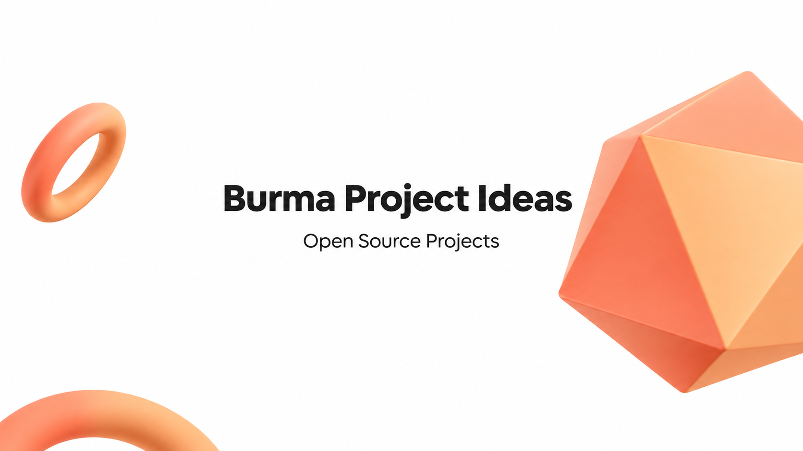

  

# Burma Project Ideas

Burma Project Ideas is a collection of practical project ideas, datasets, workflows, and example applications for developers learning to build software, especially learners from Myanmar. The goal is to give the next developer something concrete to study and recreate in their preferred programming language.

ဒီ Organization ရဲ့ အဓိက ရည်ရွယ်ချက်က နောက်လာမယ့် Developer တွေ လေ့လာနိုင်ဖို့နဲ့ ကိုယ်နှစ်သက်တဲ့ Programming Language ကို သုံးပြီး Project ပြန်ရေးကြည့်နိုင်ဖို့ ဖြစ်ပါတယ်။ Project Idea၊ JSON Data၊ App Flow နဲ့ နမူနာ Source Code တွေကို စုစည်းထားပါတယ်။ Web၊ Mobile၊ Desktop စတဲ့ Platform မျိုးစုံအတွက် လေ့ကျင့်ရေးသားနိုင်ပါတယ်။

The projects cover Myanmar language and culture, reference catalogs, calendars, games, and everyday application workflows. Many include JSON data, images, or flow diagrams; some also include working web applications and links to community implementations. You can learn from the existing implementation or build your own version with a different language or framework.

## Contributors

Thanks to the developers, testers, original creators, and community participants credited across Burma Project Ideas repositories:

  
  
  
  
  
  
  
  
  
  

  
  
  
  
  
  
  
  
  
  

  
  
  
  
  
  
  
  
  
  

  
  
  
  
  
  
  
  
  
  

  
  
  
  
  
  
  
  
  
  

  
  
  
  
  
  
  
  
  
  

  
  
  
  
  
  
  
  
  
  

  
  
  
  
  
  
  
  

## Project overview

Each repository explains its own scope, data, workflow, and setup. App and demo links below come from the existing project references; repository links are the starting point for source code and documentation.

| Project | Overview | Source / app |
| --- | --- | --- |
| Kyar Kwat (ကျားကွက်) | Traditional Burmese draughts with ကျားနိုင် / ကျားကုန် modes, local two-player play, and Easy / Medium / Hard AI in .NET 10 Blazor WebAssembly. | [kyar-kwat](https://github.com/burma-project-ideas/kyar-kwat) · [Live app](https://kyarkwat.vercel.app/) |
| Office Zoo | A workplace personality quiz with eight animal types and guidance on working together. | [office-zoo](https://github.com/burma-project-ideas/office-zoo) · [Live app](https://office-zoo.vercel.app/) |
| Burma Word Quest | A word game combining English vocabulary, Myanmar slang, and Burmese proverbs. | [burma-word-quest](https://github.com/burma-project-ideas/burma-word-quest) · [Live app](https://burma-word-quest.vercel.app/) |
| Myanmar Sar — လက်ကလေး | Myanmar handwriting practice for 33 consonants, with stroke guides and a drawing canvas. | [myanmar-sar](https://github.com/burma-project-ideas/myanmar-sar) · [Live app](https://myanmarzar.vercel.app/) |
| Burma Calendar | A month-by-month calendar of Myanmar public holidays using Gregorian dates. | [burma-calendar](https://github.com/burma-project-ideas/burma-calendar) · [Live app](https://burma-calendar.vercel.app/) |
| Burglish | A browser typing workspace recreating the Burglish 1.9 conversion test area. | [burglish](https://github.com/burma-project-ideas/burglish) · [Live app](https://burglish-blazor.vercel.app/) |
| Adhihtan | A Buddhist practice planner and prayer-bead counter with local history and backups. | [adhihtan](https://github.com/burma-project-ideas/adhihtan) · [Live app](https://adhihtan.vercel.app/) |
| Nat Myat Si (နတ်မျက်စိ) | A traditional reading app: choose a question, select a symbol, and reveal an answer. | [nat-myat-si](https://github.com/burma-project-ideas/nat-myat-si) · [Live app](https://nat-myat-si.vercel.app/) |
| Myanmar Namelogy | A Myanmar name-number calculator with traditional numerology and day-letter references. | [myanmar-namelogy](https://github.com/burma-project-ideas/myanmar-namelogy) · [Live app](https://myanmar-nameology.vercel.app/) |
| Burma Love Calculator | An entertainment app that calculates a name-matching score and shows the calculation steps. | [burma-love-calculator](https://github.com/burma-project-ideas/burma-love-calculator) · [Live app](https://blazor-burma-love-calculator.vercel.app/) |
| Word List | A searchable Myanmar word list and browser-based spelling assistant. | [word-list](https://github.com/burma-project-ideas/word-list) · [Live app](https://blazor-word-list.vercel.app/) |
| Myanmar Astro Horo | Traditional Myanmar horoscope calculations from birth date, time, and location, adapted from a VB6 reference. | [myanmar-astro-horo](https://github.com/burma-project-ideas/myanmar-astro-horo) · [Live app](https://myanmar-astro-horo.vercel.app/) |
| Mantra Calendar | A daily mantra practice calendar with customizable 90-day schedules and saved progress. | [mantra-calendar](https://github.com/burma-project-ideas/mantra-calendar) · [Live app](https://burma-mantra-calendar.vercel.app/) |
| PhayarSar | A collection of Buddhist prayers with JSON data and a browser reading app. | [phayar-sar](https://github.com/burma-project-ideas/phayar-sar) · [Live app](https://blazor-wasm-phayarsar.vercel.app/) |
| Banking Management System | A learning project covering accounts, deposits, withdrawals, transfers, and transaction history. | [banking-management-system](https://github.com/burma-project-ideas/banking-management-system) · [Live app](https://blazor-wasm-banking-management-system.vercel.app/) |
| Fruits | An illustrated fruit catalog with Myanmar-name search and expandable descriptions. | [fruits](https://github.com/burma-project-ideas/fruits) · [Live app](https://burma-fruits.vercel.app/) |
| Collin Radio (Melodic Journeys of Collin) | Collin Radio: a music catalog with playback, albums, favorites, and a DJ Room. | [melodic-journeys-of-collin](https://github.com/burma-project-ideas/melodic-journeys-of-collin) · [Live app](https://burma-collin.vercel.app/) |
| Burmese Agriculture | A collection of Burmese articles about growing and caring for plants. | [burmese-agriculture](https://github.com/burma-project-ideas/burmese-agriculture) · [Live app](https://blazor-wasm-burmese-agriculture.vercel.app/) |
| Burmese Recipes | A catalog of Myanmar dishes, recipe information, and food photographs. | [burmese-recipes](https://github.com/burma-project-ideas/burmese-recipes) · [Live app](https://blazor-wasm-burmese-recipes.vercel.app/) |
| Quotlets | An image-and-quotation collection linking entries to their creators. | [quotlets](https://github.com/burma-project-ideas/quotlets) · [Live app](https://blazor-wasm-quotlets.vercel.app/) |
| Missing Historical Records | A book-reading project using a book catalog and page content stored as JSON. | [missing-historical-records](https://github.com/burma-project-ideas/missing-historical-records) · [Live app](https://blazor-wasm-missing-historical-records.vercel.app/) |
| Incompatible Food | A catalog of traditional food-combination claims, used to practice filtering and pagination. | [incompatible-food](https://github.com/burma-project-ideas/incompatible-food) · [Live app](https://blazor-wasm-incompatible-food.vercel.app/) |
| Art Gallery | A gallery of Myanmar artists' work with artwork descriptions. | [art-gallery](https://github.com/burma-project-ideas/art-gallery) · [Live app](https://blazor-wasm-art-gallery.vercel.app/) |
| Snakes | An illustrated snake catalog with species descriptions and recorded characteristics. | [snakes](https://github.com/burma-project-ideas/snakes) · [Live app](https://blazor-wasm-snakes.vercel.app/) |
| Myanmar Months | A guide to Myanmar months, their seasonal flowers, and traditional festivals. | [myanmar-months](https://github.com/burma-project-ideas/myanmar-months) · [Live app](https://blazor-wasm-myanmar-months.vercel.app/) |
| Birds | A bird catalog with Myanmar and English names, photographs, and descriptions. | [birds](https://github.com/burma-project-ideas/birds) · [Live app](https://blazor-wasm-birds.vercel.app/) · [Live API](https://fake-birds-apis.vercel.app/) |
| Bagan Map | A map-based project connecting Bagan travel routes, pagodas, locations, and historical details. | [bagan-map](https://github.com/burma-project-ideas/bagan-map) · [Live app](https://blazor-wasm-bagan-trip.vercel.app/) |
| Myanmar Proverbs | Burmese proverbs organized by initial letter, with explanations of their meanings. | [myanmar-proverbs](https://github.com/burma-project-ideas/myanmar-proverbs) |
| Zodiac | A birthday-based zodiac explorer with signs, personality descriptions, and Myanmar-language readings. | [zodiac](https://github.com/burma-project-ideas/zodiac) · [Live app](https://blazor-zodiac.vercel.app/) |
| Pick A Pile | A question-and-picture selection project that reveals a corresponding reading. | [pick-a-pile](https://github.com/burma-project-ideas/pick-a-pile) · [Live app](https://blazor-wasm-pick-a-pile.vercel.app/) |
| Movie Ticket Online Booking System | A sample booking flow for choosing a movie, cinema, room, showtime, and seats, then producing ticket vouchers. | [movie-ticket-online-booking-system](https://github.com/burma-project-ideas/movie-ticket-online-booking-system) · [Live app](https://blazor-wasm-mtobs.vercel.app/) |
| Dream Dictionary | Traditional dream interpretations organized by Myanmar letter and searchable topic. | [dream-dictionary](https://github.com/burma-project-ideas/dream-dictionary) · [Demo (unverified)](https://blazor-wasm-dream-dictionary.vercel.app/) |
| Min Thein Kha - Lat Htauk Bay Din | A traditional divination project matching a chosen question and grid number to an answer. | [min-thein-kha-lat-htauk-bay-din](https://github.com/burma-project-ideas/min-thein-kha-lat-htauk-bay-din) · [Live app](https://mintheinkha-lathtaukbaydin.vercel.app/) |

## Start learning

1. Choose a project that interests you and read its README and workflow.
2. Inspect the available data and build the smallest useful flow, such as a list and a detail page.
3. Add the project's search, navigation, calculations, or saved progress as you learn.
4. Use your preferred language or framework. Follow the repository's contribution guidance when sharing improvements or another implementation.

## Credits and reuse

These projects include work by multiple developers and content from original creators and upstream sources. Keep their attribution when adapting a project. Check each repository's license and source notices before reusing code, data, images, music, or text; permission for one does not automatically cover the others.

Project contributors and source credits

Git contribution credits and original content authorship are distinct. The references below are retained from the project catalog; each project's README contains its detailed credits and notices.

| Project | Contributors / source credits |
| --- | --- |
| [Kyar Kwat (ကျားကွက်)](https://github.com/burma-project-ideas/kyar-kwat) | [@sannlynnhtun-coding](https://github.com/sannlynnhtun-coding) (app); [Myanmar checkers](https://harryheinthant.site/checker) (rules reference); font licenses and detailed credits in the [project README](https://github.com/burma-project-ideas/kyar-kwat#readme); [Tiger + Doe Pyar logo assets](https://github.com/burma-project-ideas/kyar-kwat/blob/main/docs/BRANDING.md) |
| [Office Zoo](https://github.com/burma-project-ideas/office-zoo) | [Harry Hein (@kaungmyathein)](https://github.com/kaungmyathein) (original creator and content); [@sannlynnhtun-coding](https://github.com/sannlynnhtun-coding) (repository maintenance) |
| [Burma Word Quest](https://github.com/burma-project-ideas/burma-word-quest) | [Sai Wanna Tun (@SaiWunnaTun-KP, formerly Jeff307-kib)](https://github.com/SaiWunnaTun-KP/End-Game) (original Assembly: End-Game); [@sannlynnhtun-coding](https://github.com/sannlynnhtun-coding) (additional development); [Ban Sagar](https://bansagar.com/) (slang); Dr. Win Thein (proverbs; see [source credits](https://github.com/burma-project-ideas/burma-word-quest#readme)) |
| [Myanmar Sar — လက်ကလေး](https://github.com/burma-project-ideas/myanmar-sar) | [@sannlynnhtun-coding](https://github.com/sannlynnhtun-coding) (app); worksheet creator not identified |
| [Burma Calendar](https://github.com/burma-project-ideas/burma-calendar) | [@sannlynnhtun-coding](https://github.com/sannlynnhtun-coding) |
| [Burglish](https://github.com/burma-project-ideas/burglish) | Git contributors: [@sannlynnhtun-coding](https://github.com/sannlynnhtun-coding), [@theinhtetaung-dev](https://github.com/theinhtetaung-dev); Source: [Burglish.com / Soe Min .NET](https://burglish.my-mm.org/latest/trunk/web/testarea.htm) (original conversion engine; [source notice](https://github.com/burma-project-ideas/burglish/blob/master/THIRD-PARTY-NOTICES.md)) |
| [Adhihtan](https://github.com/burma-project-ideas/adhihtan) | [Yan Naing Htin Kyaw](https://th.linkedin.com/in/yan-naing-htin-kyaw-5b6570256) (original Android app); [@sannlynnhtun-coding](https://github.com/sannlynnhtun-coding) (Blazor recreation inspired by its flow) |
| [Nat Myat Si (နတ်မျက်စိ)](https://github.com/burma-project-ideas/nat-myat-si) | [@sannlynnhtun-coding](https://github.com/sannlynnhtun-coding) (app); original question/answer author not identified |
| [Myanmar Namelogy](https://github.com/burma-project-ideas/myanmar-namelogy) | [@sannlynnhtun-coding](https://github.com/sannlynnhtun-coding); [@thirilinn-dev](https://github.com/thirilinn-dev) (testing); additional contributors listed in the [project README](https://github.com/burma-project-ideas/myanmar-namelogy#readme); original numerology source not identified |
| [Burma Love Calculator](https://github.com/burma-project-ideas/burma-love-calculator) | [@sannlynnhtun-coding](https://github.com/sannlynnhtun-coding) |
| [Word List](https://github.com/burma-project-ideas/word-list) | [Kanaung Wordlists](https://github.com/kanaung/wordlists) (wordlist data), [@sannlynnhtun-coding](https://github.com/sannlynnhtun-coding) (app) |
| [Myanmar Astro Horo](https://github.com/burma-project-ideas/myanmar-astro-horo) | [@sannlynnhtun-coding](https://github.com/sannlynnhtun-coding) (Blazor port); [fossmyanmar/myanmar_astro_horo](https://github.com/fossmyanmar/myanmar_astro_horo) (VB6 calculation and city-data reference) |
| [Mantra Calendar](https://github.com/burma-project-ideas/mantra-calendar) | [@sannlynnhtun-coding](https://github.com/sannlynnhtun-coding), [@myatphonethant-dev](https://github.com/myatphonethant-dev) |
| [PhayarSar](https://github.com/burma-project-ideas/phayar-sar) | [@sannlynnhtun-coding](https://github.com/sannlynnhtun-coding) |
| [Banking Management System](https://github.com/burma-project-ideas/banking-management-system) | Git contributors: [@sannlynnhtun-coding](https://github.com/sannlynnhtun-coding); Source: [MIMU Place Codes](https://themimu.info/place-codes) (state/township data) |
| [Fruits](https://github.com/burma-project-ideas/fruits) | Git contributors: [@sannlynnhtun-coding](https://github.com/sannlynnhtun-coding), [@zinlynhtet](https://github.com/zinlynhtet); original fruit data/image creators not identified |
| [Collin Radio (Melodic Journeys of Collin)](https://github.com/burma-project-ideas/melodic-journeys-of-collin) | [@sannlynnhtun-coding](https://github.com/sannlynnhtun-coding) (Blazor app); Collin and credited collaborators (music and artwork; see [project credits](https://github.com/burma-project-ideas/melodic-journeys-of-collin#readme)) |
| [Burmese Agriculture](https://github.com/burma-project-ideas/burmese-agriculture) | Git contributors: [@sannlynnhtun-coding](https://github.com/sannlynnhtun-coding), [@zinlynhtet](https://github.com/zinlynhtet); Source: [အစိမ်းရောင်လမ်း / Green Way](https://greenwaymyanmar.com/) (agriculture content) |
| [Burmese Recipes](https://github.com/burma-project-ideas/burmese-recipes) | [@sannlynnhtun-coding](https://github.com/sannlynnhtun-coding), [@zinlynhtet](https://github.com/zinlynhtet), [@mgchit-coding](https://github.com/mgchit-coding) |
| [Quotlets](https://github.com/burma-project-ideas/quotlets) | [@sannlynnhtun-coding](https://github.com/sannlynnhtun-coding) |
| [Missing Historical Records](https://github.com/burma-project-ideas/missing-historical-records) | [@sannlynnhtun-coding](https://github.com/sannlynnhtun-coding), [@zinlynhtet](https://github.com/zinlynhtet) |
| [Incompatible Food](https://github.com/burma-project-ideas/incompatible-food) | [@myatphonethant-dev](https://github.com/myatphonethant-dev), [@sannlynnhtun-coding](https://github.com/sannlynnhtun-coding) |
| [Art Gallery](https://github.com/burma-project-ideas/art-gallery) | [@sannlynnhtun-coding](https://github.com/sannlynnhtun-coding) |
| [Snakes](https://github.com/burma-project-ideas/snakes) | [@mgchit-coding](https://github.com/mgchit-coding), [@sannlynnhtun-coding](https://github.com/sannlynnhtun-coding), [@myatphonethant-dev](https://github.com/myatphonethant-dev), [@phyuphyuthin-coding](https://github.com/phyuphyuthin-coding) |
| [Myanmar Months](https://github.com/burma-project-ideas/myanmar-months) | [@sannlynnhtun-coding](https://github.com/sannlynnhtun-coding), [@phyuphyuthin-coding](https://github.com/phyuphyuthin-coding), [@myatphonethant-dev](https://github.com/myatphonethant-dev) |
| [Birds](https://github.com/burma-project-ideas/birds) | Git contributors: [@sannlynnhtun-coding](https://github.com/sannlynnhtun-coding), [@myatphonethant-dev](https://github.com/myatphonethant-dev); Source: Birds In Nature Facebook Group (bird information, as credited in the [project README](https://github.com/burma-project-ideas/birds#readme)) |
| [Bagan Map](https://github.com/burma-project-ideas/bagan-map) | [@sannlynnhtun-coding](https://github.com/sannlynnhtun-coding), [@myatphonethant-dev](https://github.com/myatphonethant-dev) |
| [Myanmar Proverbs](https://github.com/burma-project-ideas/myanmar-proverbs) | Git contributors: [@sannlynnhtun-coding](https://github.com/sannlynnhtun-coding), [@naykhantkyaw-coding](https://github.com/naykhantkyaw-coding), [@phyuphyuthin-coding](https://github.com/phyuphyuthin-coding), [@myatphonethant-dev](https://github.com/myatphonethant-dev); Source: [Dr. Win Thein / mmproverbs.pro](https://www.mmproverbs.pro/2018/12/blog-post_18.html) (proverb content) |
| [Zodiac](https://github.com/burma-project-ideas/zodiac) | Git contributors: [@sannlynnhtun-coding](https://github.com/sannlynnhtun-coding), [@OatSoeK](https://github.com/OatSoeK), [@myatphonethant-dev](https://github.com/myatphonethant-dev), [@naykhantkyaw-coding](https://github.com/naykhantkyaw-coding), [@phyuphyuthin-coding](https://github.com/phyuphyuthin-coding), [@mgchit-coding](https://github.com/mgchit-coding); Source: [Mind Maestro](https://www.mindmaestro.co.uk/zodiac-art) (zodiac artwork); [KnowProgram](https://www.knowprogram.com/js/chinese-zodiac-calculator-in-javascript/) (Chinese zodiac calculation reference) |
| [Pick A Pile](https://github.com/burma-project-ideas/pick-a-pile) | [@sannlynnhtun-coding](https://github.com/sannlynnhtun-coding), [@OatSoeK](https://github.com/OatSoeK) |
| [Movie Ticket Online Booking System](https://github.com/burma-project-ideas/movie-ticket-online-booking-system) | [@mgchit-coding](https://github.com/mgchit-coding), [@sannlynnhtun-coding](https://github.com/sannlynnhtun-coding), [@OatSoeK](https://github.com/OatSoeK), [@phyuphyuthin-coding](https://github.com/phyuphyuthin-coding) |
| [Dream Dictionary](https://github.com/burma-project-ideas/dream-dictionary) | Git contributors: [@sannlynnhtun-coding](https://github.com/sannlynnhtun-coding), [@OatSoeK](https://github.com/OatSoeK); Source: အိမ်မက်အမျိုးမျိုးနှင့်အသားလှုပ်နိမိတ် (book content cited in the [project README](https://github.com/burma-project-ideas/dream-dictionary#readme); author not identified there) |
| [Min Thein Kha - Lat Htauk Bay Din](https://github.com/burma-project-ideas/min-thein-kha-lat-htauk-bay-din) | [@sannlynnhtun-coding](https://github.com/sannlynnhtun-coding), [@OatSoeK](https://github.com/OatSoeK) |

## Organization repositories

[.github](https://github.com/burma-project-ideas/.github) maintains this organization profile and shared branding.
